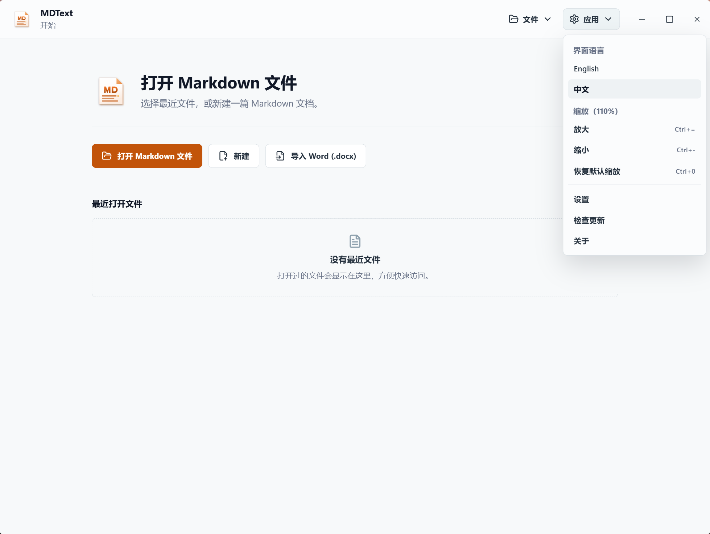
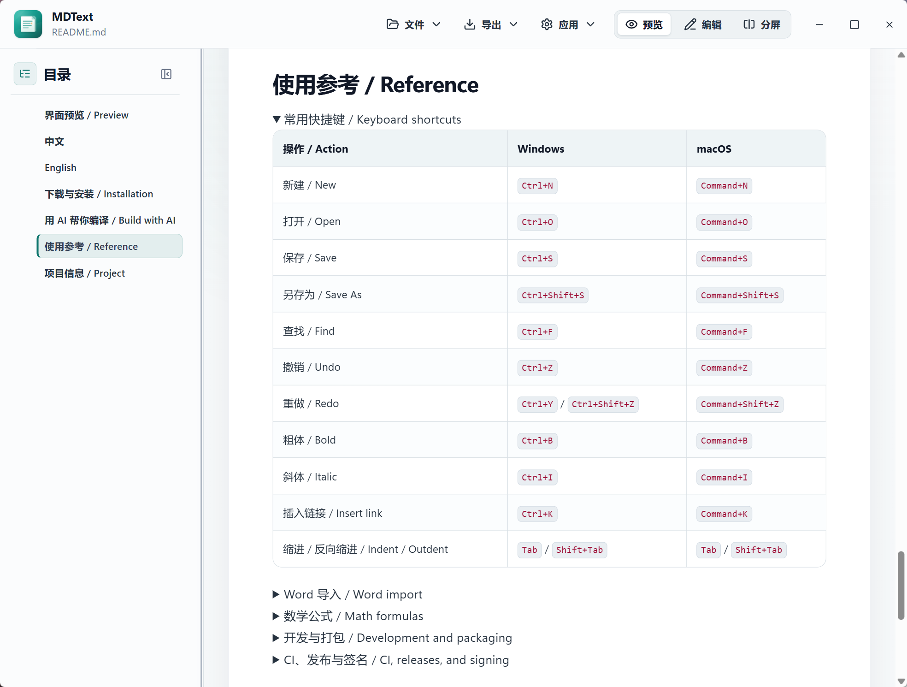

<div align="center">
  
  <h1>MDText</h1>
  <p><strong>轻量 Markdown 阅读器</strong></p>
  <p>美观易读 · 打开轻快 · 免费无广告</p>
  <p>
    <a href="https://github.com/DOTATONG/MDText/releases/latest"></a>
    <a href="LICENSE"></a>
    
  </p>
  <p>
    <a href="https://github.com/DOTATONG/MDText/releases/latest"><strong>下载</strong></a>
    · <strong>中文</strong>
    · <a href="README.en.md">English</a>
  </p>
  <p><sub>非官方 fork，基于 <a href="https://github.com/isunky/MDView">isunky/MDView</a>（原作者 Sunky）</sub></p>
</div>

---

## 界面预览

<table>
  <tr>
    <td width="50%" align="center">
      <a href="docs/assets/screenshots/main.png"></a>
      <br /><sub>欢迎页</sub>
    </td>
    <td width="50%" align="center">
      <a href="docs/assets/screenshots/main2.png"></a>
      <br /><sub>阅读工作区</sub>
    </td>
  </tr>
</table>

## 功能简介

MDText 是一款轻量、美观、免费无广告的 Markdown 阅读器。在清晰的排版中阅读 `.md` 文件；打开轻快，无需注册，也适合已有的本地文档。需要时还能顺手修改几处内容，或导出一份排版整洁的文档。

- **打开即读** — 双击、右键“打开方式”或拖入窗口；Windows 绿色版可在设置中加入“打开方式”，无需管理员权限；支持多窗口打开。
- **舒适排版** — 明暗主题，字体、字号、行距与正文宽度可调；界面缩放（`Ctrl` + `-`/`+`/`0`）会被记住。
- **长文导航** — 可折叠多级目录、当前位置高亮；重开文件恢复阅读进度与视图设置。
- **图表与公式** — Mermaid、LaTeX、表格与代码高亮；支持色值色块；图表和图片可缩放、拖动、适应窗口，并在预览中按序浏览与保存。
- **轻量编辑** — 源码编辑与同步分屏；图片粘贴、拖入或批量插入；查找替换、撤销重做、草稿恢复。
- **Word 转换与导出** — 导入 Word 为 Markdown 草稿；导出 Word、独立 HTML，或打印为 PDF。

## 下载与安装

从 [GitHub Releases](https://github.com/DOTATONG/MDText/releases/latest) 选择适合的版本。

| 平台           | 推荐方式                                                  |
|----------------|-----------------------------------------------------------|
| Windows        | **MSI**：安装、文件关联与更新检查                         |
| Windows 绿色版 | **ZIP**：解压后运行                                       |
| macOS          | **[本机源码编译](docs/BUILD_WITH_AI.md)**（推荐 AI 辅助） |
| Microsoft Edge | **Extension ZIP**：解压后加载                             |

### 环境与文件关联

- **Windows** — 需预先安装 [WebView2 Runtime](https://developer.microsoft.com/en-us/microsoft-edge/webview2/)，MDText 不附带或下载。MSI 安装界面为英文，应用支持中英文。
- **macOS** — 发布包为 Universal DMG（Intel 与 Apple Silicon，macOS 10.15+），尚未完成 Apple 签名与公证，建议在自己的 Mac 上源码编译；本地构建仍可能出现系统安全提示。
- **Edge 扩展** — 在 `edge://extensions` 开启开发人员模式，选择“加载解压缩的扩展”，选中解压后含 `manifest.json` 的文件夹。
- **文件关联** — MSI 默认关联 `.md` 和 `.markdown`，安装时可取消；绿色版解压后不注册任何关联，可在“设置”中把 MDText 加入“打开方式”列表，无需管理员权限，再次点击同一按钮即可移除。

静默安装时可禁用文件关联（请替换为实际 MSI 文件名）：

```powershell
msiexec /i MDText_x64.msi ASSOCIATE_MARKDOWN_FILES=0 /qn
```

签名状态以各版本发布说明为准；详见[代码签名政策](CODE_SIGNING_POLICY.md)。

## AI 辅助编译

让能操作本地终端的 AI 编程工具协助构建：

1. 从 [Releases](https://github.com/DOTATONG/MDText/releases/latest) 下载 **Source code (zip)** 并解压。
2. 在目标系统上用 AI 工具打开项目文件夹（Mac 在 Mac 上编译，Windows 在 Windows 上编译）。
3. 发送 [docs/BUILD_WITH_AI.md](docs/BUILD_WITH_AI.md) 中的现成提示词，按提示安装依赖，等待安装包路径。

## 使用参考

### 常用快捷键

| 操作            | Windows                   | macOS               |
|-----------------|---------------------------|---------------------|
| 新建            | `Ctrl+N`                  | `Command+N`         |
| 打开            | `Ctrl+O`                  | `Command+O`         |
| 保存            | `Ctrl+S`                  | `Command+S`         |
| 另存为          | `Ctrl+Shift+S`            | `Command+Shift+S`   |
| 查找            | `Ctrl+F`                  | `Command+F`         |
| 撤销            | `Ctrl+Z`                  | `Command+Z`         |
| 重做            | `Ctrl+Y` / `Ctrl+Shift+Z` | `Command+Shift+Z`   |
| 粗体            | `Ctrl+B`                  | `Command+B`         |
| 斜体            | `Ctrl+I`                  | `Command+I`         |
| 插入链接        | `Ctrl+K`                  | `Command+K`         |
| 缩进 / 反向缩进 | `Tab` / `Shift+Tab`       | `Tab` / `Shift+Tab` |

### 数学公式

`$...$` 插入行内公式，单独成行的 `$$` 包裹公式块；编辑时点击 `Σ` 使用模板与实时预览，普通美元符号写为 `\$`。

### Word 导入

Word 转换在本机完成，首次使用需要 Python 和转换组件，下载组件需要联网。

### 开发与打包

技术栈：Tauri 2 · React 19 · TypeScript · Vite。

准备 Node.js 24、Rust/Cargo 和[对应平台构建工具](https://v2.tauri.app/start/prerequisites/)，然后运行：

```bash
npm ci
npm run desktop:dev
```

| 目标                                 | 命令                                     |
|--------------------------------------|------------------------------------------|
| Windows MSI                          | `npm run desktop:build -- --bundles msi` |
| Windows MSI + Portable ZIP + SHA-256 | `npm run package:windows`                |
| macOS DMG                            | `npm run desktop:build -- --bundles dmg` |
| Edge ZIP                             | `npm run edge:package`                   |

验证：`npm test` · `npm run lint` · `npm run build` · `npm run test:e2e`。

版本管理：`npm run version:sync -- <major.minor.patch>`，然后 `npm run version:check`。

维护者资料：[`ROADMAP.md`](ROADMAP.md) · [`工程目录说明`](docs/PROJECT_STRUCTURE.md) · [`Fork 发布指南`](docs/FORK_RELEASING.md)。

### CI、发布与签名

推送与 PR 执行质量检查；手动运行 CI 额外生成桌面安装包。推送 `v*` Tag 或运行 Release 工作流可发布 GitHub Release。详见 [`FORK_RELEASING.md`](docs/FORK_RELEASING.md)。

| 集成             | 配置                                                                                        |
|------------------|---------------------------------------------------------------------------------------------|
| Windows SignPath | Secret: `SIGNPATH_API_TOKEN`；Variable: `SIGNPATH_ORGANIZATION_ID`                          |
| Tauri updater    | Secrets: `TAURI_SIGNING_PRIVATE_KEY`、`TAURI_SIGNING_PRIVATE_KEY_PASSWORD`                  |
| Edge Add-ons     | Secret: `EDGE_ADDONS_API_KEY`；Variables: `EDGE_ADDONS_CLIENT_ID`、`EDGE_ADDONS_PRODUCT_ID` |

SignPath 签名仅用于 Release，需完成配置与审批；Edge 首次发布需在 Microsoft Partner Center 创建产品。macOS Developer ID 签名与公证尚未配置。

## 项目信息

| 项目   | 内容                                                                               |
|--------|------------------------------------------------------------------------------------|
| 版本   | 4.0.2                                                                              |
| 作者   | [DOTATONG](https://github.com/DOTATONG)（fork 维护者）                             |
| 原作者 | [Sunky](https://www.sunky.net) / [isunky/MDView](https://github.com/isunky/MDView) |
| 许可证 | [GPL-3.0](LICENSE)                                                                 |

MDText 是 [MDView](https://github.com/isunky/MDView) 的非官方分支，保留原项目的 GPL-3.0 许可证与原作者署名。

第三方依赖保留原许可证。
